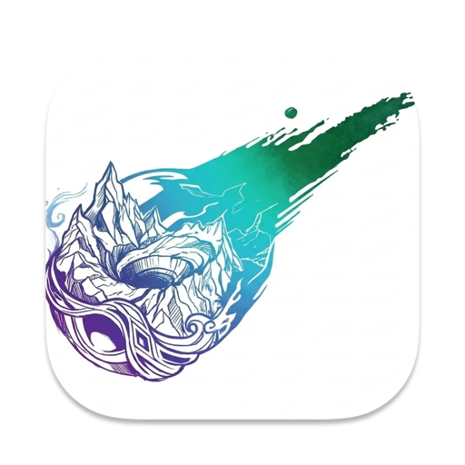

<p align="center">
  
</p>

<h1 align="center">NorthernCrater</h1>

<p align="center">
  A mod manager and launcher for <b>FINAL FANTASY VII</b> on Apple Silicon Macs.<br>
  It builds a native version of the game from <i>your own</i> Steam copy, then lets you pick mods, tune graphics and controls, manage saves and play.
</p>

---

## Contents

1. [What it is](#what-it-is)
2. [Requirements](#requirements)
3. [Install](#install)
4. [First run: build the game](#first-run-build-the-game)
5. [Using the app](#using-the-app)
   - [Mods](#mods) · [Mod catalog](#mod-catalog) · [Settings](#settings) · [Controls](#controls) · [Saves](#saves) · [Playing](#playing)
6. [Things to know (caveats)](#things-to-know-caveats)
7. [Troubleshooting](#troubleshooting)
8. [Where things live on disk](#where-things-live-on-disk)
9. [How it works](#how-it-works)
10. [For developers](#for-developers)
11. [Credits and license](#credits-and-license)

---

## What it is

NorthernCrater has two parts:

- **The app** (`NorthernCrater/`, Swift and SwiftUI): choose your game folder, build and launch the game, manage mods and their load order, browse a mod catalog, edit settings and controls, and import saves.
- **The engine** (`engine/`): a vendored, modified copy of the macOS engine from [GJ Materia](https://github.com/goodjoeth/gj-materia), itself a macOS port of FF7Recomp (the game statically recompiled to C, with the FFNx renderer on Metal). The engine app is called **NorthernCrater Engine** and has no window of its own until the game starts. The app drives it.

The game runs as a **native Apple Silicon (arm64)** program. It is built on your Mac, from your game files. Nothing from the game is included in this repository.

## Requirements

| | |
|---|---|
| **Mac** | Apple Silicon (M1 or newer). Intel Macs are not supported. |
| **macOS** | The project's deployment target is **macOS 26.5**, and that is the version it has been built and tested on. On an older macOS you would have to lower the deployment target in Xcode yourself; I have not tried that. |
| **Xcode** | A recent Xcode (built with 26.6) to compile the app. |
| **Tools** | Xcode Command Line Tools, plus Homebrew packages `cmake`, `ninja` and `python3`. The app checks for `git`, `cmake`, `ninja`, `python3` and `clang` before building. |
| **Disk space** | About **6 GB** free. The engine build cache was 5.6 GB on the machine this was developed on (most of it downloaded sources). |
| **Internet** | Needed for the first build (the build downloads about 20 pinned third-party projects: pcrecomp, FFNx, bgfx, SDL3, FFmpeg and others) and for the mod catalog. |
| **The game** | **FINAL FANTASY VII, the new Steam release**, app ID 3837340, Windows files (see [Getting the game files on a Mac](#getting-the-game-files-on-a-mac)). |

### Which game version works

Only the **new release** is supported. On disk its folder is called `FINAL FANTASY VII Steam Edition`, and the app needs these two things inside it:

- `ff7/resources/ff7_1.02/ff7_en` (the 1.02 English executable, SHA-1 `ac306ae92615af75ff36bba6347c67ca1284151d`)
- `ff7/workingdir/data`

The **2013 Edition** (it has `FF7_Launcher.exe`) is **not supported** and the app tells you so. The conversion and every renderer patch are tied to the 1.02 executable. Saves from the 2013 Edition (`save00.ff7`) *are* compatible, so you can bring them over (see [Saves](#saves)).

### Getting the game files on a Mac

NorthernCrater runs the game's **Windows** files, so you need the Windows download of the game. You must own it on Steam. Pick one way:

**Option A: the Steam app, set to download Windows files.** This is the route that has been confirmed to work. The Steam app on a Mac normally offers only Mac builds. One line in a small settings file (a Steam developer option) makes it ask for the Windows build instead. Quit Steam, then run:

```sh
echo "@sSteamCmdForcePlatformType windows" > ~/Library/Application\ Support/Steam/Steam.AppBundle/Steam/Contents/MacOS/steam_dev.cfg
```

Then open Steam again, find **FINAL FANTASY VII** (the new release, app ID **3837340**, about 3.7 GB) in your library and install it. The files end up here, and this is the folder you choose in NorthernCrater:

```
~/Library/Application Support/Steam/steamapps/common/FINAL FANTASY VII Steam Edition
```

> **Undo it afterwards.** The setting tells Steam to ask for the **Windows** build, and it is not limited to this game. While the file exists, expect Steam to offer Windows builds for other games too, including ones that have a real Mac version. Once the game is installed, delete the file and restart Steam:
>
> ```sh
> rm ~/Library/Application\ Support/Steam/Steam.AppBundle/Steam/Contents/MacOS/steam_dev.cfg
> ```
>
> The file sits inside Steam's own app folder, so a Steam update may remove it. If the game stops showing up later, run the first command again. (The `>` replaces the file's contents; that is fine unless you keep other developer settings in it.)

**Option B: SteamCMD.** If you would rather not change Steam's settings, download the Windows files from the command line instead:

```sh
brew install --cask steamcmd

steamcmd +@sSteamCmdForcePlatformType windows \
         +force_install_dir "$HOME/FF7" \
         +login YOUR_STEAM_USERNAME \
         +app_update 3837340 validate \
         +quit
```

- Replace `YOUR_STEAM_USERNAME` with the Steam account that owns the game. SteamCMD asks for the password, and for the Steam Guard code if you use one.
- The order matters: the platform and install-folder commands must come **before** `+login`.
- The download is about 3.7 GB. Afterwards, choose the `~/FF7` folder in NorthernCrater. The folder's name does not matter; the app only checks that it contains `ff7/resources/ff7_1.02/ff7_en` and `ff7/workingdir/data`.
- **Use app ID 3837340, not 39140.** 39140 is the 2013 Edition, which does not work.

> **Untested:** the SteamCMD command has not been run end to end yet. The app ID, size and folder name come from a working Steam install on the developer's Mac, and the command follows SteamCMD's documented options. If it fails, use Option A, which has been confirmed.

## Install

There is no packaged download yet. You build the app yourself in Xcode.

1. **Get the game files** (see [Getting the game files on a Mac](#getting-the-game-files-on-a-mac) above).
2. **Install the Command Line Tools:**
   ```sh
   xcode-select --install
   ```
3. **Install the build tools with [Homebrew](https://brew.sh):**
   ```sh
   brew install cmake ninja python3
   ```
4. **Get the project and open it:**
   ```sh
   git clone <this repository>
   cd NorthernCrater
   open NorthernCrater.xcodeproj
   ```
5. In Xcode, choose the **NorthernCrater** scheme and press **Run** (⌘R). The project signs locally ("Sign to Run Locally"), so you do not need an Apple developer account or team. If you have one and want a signed build, set your team under *Signing & Capabilities*.

The app itself installs nothing system-wide: everything it creates lives in your user Library (see [Where things live on disk](#where-things-live-on-disk)), and your Steam folder is only ever read, never written to.

## First run: build the game

The app opens on the **home page**. Two steps:

1. **Select your game folder.** Press **Select FINAL FANTASY VII Folder…** (or the folder icon in the toolbar) and choose your game folder (the one from [Getting the game files](#getting-the-game-files-on-a-mac), for example `FINAL FANTASY VII Steam Edition`). The app checks it and remembers it for next time. A wrong folder or the 2013 Edition gives a clear message.
2. **Build the engine.** Press **Build Engine**. This:
   - copies the engine sources to `~/Library/Caches/NorthernCrater/engine` (a path without spaces, because the build scripts cannot handle spaces),
   - sets up a private Python environment for the converter,
   - imports your game files, converts the game's code to C, builds FFmpeg and the Metal shaders, compiles everything and prepares the game folder.

   **The first build takes 15 to 30 minutes** and a lot of CPU. Later builds are incremental and much faster. A log scrolls in the app while it works. When the status says **Engine Ready**, you can play.

Only one build can run at a time. If you start a second one, the build fails at once and the log says "another engine build is already running" (exit code 75).

You only need to build once. You rebuild only if you update the engine, or if something breaks.

## Using the app

The window has the mod list on the left (the **load order**: the top mod wins when two mods change the same thing), the selected mod's page on the right, and a status bar at the bottom. Hover over any toolbar icon to see what it does.

| Toolbar icon | What it does |
|---|---|
| **Home** | Back to the home page (game folder, build, settings). |
| **Steam Folder** | Choose or change your game folder. |
| **+ Add Mods** | Add `.iro` files or mod folders. |
| **Catalog** (globe) | Browse and download mods online. |
| **Saves** | See, import and inspect save files. |
| **Settings** | Resolution, aspect ratio, anti-aliasing, lighting, VSync, 60 FPS, analog movement, FPS counter. |
| **Controls** (gamepad) | Keyboard layout and controller options. |
| **Play** | Start the game. |

### Mods

**Adding mods.** Use **+ Add Mods**, then **Add Mod Files…** or **Add Mod Folders…**, and select as many as you like at once. You can also **drag and drop** files and folders from Finder onto the mod list.

- Supported: **`.iro` files** (7th Heaven's format) and **unpacked mod folders** (a folder that has a `mod.xml`, or a folder that wraps exactly one such folder).
- **Not supported: `.7z` and `.zip`.** Unpack them first, then add the result. The app tells you when it sees one.
- Mods already in your list are skipped. If some fail, the rest are still added, and an alert lists what failed and why.
- Your mods stay where they are. The app links them from its own folder and never moves or deletes your files.

**Load order and switching on or off.** Drag a mod up or down to change its priority. The checkbox turns a mod on or off without removing it. **Auto-Sort** orders them by category the way 7th Heaven does.

An **orange warning triangle** next to a mod means another enabled mod is in the same category (for example two World Textures mods), so they may overlap. It is a hint, not an error: many such mods work together, and the one higher in the list wins where they clash. Hover over it to read the message.

**Configuring a mod.** Click a mod to open its page, laid out like 7th Heaven's Configure window:

- On the left, the mod's options. Headings such as "World Screen" become collapsible groups.
- On the right, the selected option's description, a dropdown (or a switch for plain on/off options) and a **large preview picture** of the choice you picked, so you can see what it will look like. Click **About this mod** at the top of the list for the mod's own picture, author and version.
- Some options also have a **Play sound preview** button (currently Symphonic Remasters). The sound is decoded on demand, and this needs the engine to have been built once.
- Animated GIF previews show their first frame only.

Your choices are saved automatically.

### Mod catalog

Press **Catalog** to browse mods from the official 7th Heaven catalogs (Qhimm and Sega). You can search, filter by category and refresh. Press **Download** next to a mod and it is added to your list when it finishes. Downloads are stored in the app's mods folder. The Catalog button is greyed out until you have chosen a game folder.

Some catalog links point to hosts that can be slow or limit downloads; if one fails, try again later or download the mod yourself and add the file.

### Settings

Open **Settings** (the sliders icon). The app writes the game's graphics configuration (`FFNx.toml`) from these values **every time you press Play**.

| Setting | What it does |
|---|---|
| **Internal Resolution** | How large the game is drawn internally (1x original, 2x, 4x). Higher is sharper and costs more GPU. |
| **Aspect Ratio** | 4:3 original, 16:9, 16:10 or 21:9. Some mods choose widescreen layouts based on this. |
| **60 FPS** | Runs the game at 60 frames per second. A mod's own FPS option, if it has one, takes precedence. |
| **Anti-aliasing** | Off, 2x, 4x, 8x or 16x. Smooths jagged edges. Costs GPU. Default is Off. |
| **Real-time lighting and shadows** | FFNx's lighting mode. Some mods, such as Cosmos Gaia, turn it on themselves; this switch forces it on whatever the mods say. Costs GPU. |
| **VSync** | Waits for the screen's refresh before showing a frame. No tearing, a little more delay. Turn it off if the game feels laggy. |
| **Analog stick movement** | Walk in any direction with a controller stick. |
| **Show FPS counter** | Draws the frame rate on screen. Useful for finding a slowdown. |

**What mods can change.** A mod can ask for its own graphics settings (music, lighting, time cycle, animations and more). The app applies those after your settings, for enabled mods whose options match. Turning a mod off removes its effect on the next Play.

### Controls

Open **Controls** (the gamepad icon).

**Keyboard tab.** Every game button is listed with its keys. Press **+**, then press the key you want. A key can only do one thing, so reusing it moves it from the other button (a note tells you). **Esc** cancels. **Reset to defaults** restores the built-in layout. Command shortcuts and **F1** cannot be used (F1 opens the in-game achievements panel).

Default keys: arrows to move, **Return** or **K** to confirm, **Delete** or **J** to cancel, **Space** or **I** for the menu, **Shift** or **U** for the special button, **Q** and **W** for L1 and R1, **1** and **2** for L2 and R2, **Tab** for Select, **P** for Start.

The layout is saved to `keymap.txt` and read when the game starts.

**Controller tab.** Shows the connected controllers and a live test: buttons light up and the sticks and triggers move as you use them. You can set:

- **Swap confirm and cancel** exchanges the controller's A and B buttons, for people who want the other layout. The keyboard is not affected.
- **Analog movement**, **walk or run by how far the stick is tilted**, and a **dead zone** for each stick. Raise a dead zone if your character drifts.
- **Battle camera** inversion, vertical and horizontal.

**Limit:** controller buttons are not freely remappable here. The engine maps each button to a fixed Xbox-style button. To change what a game button does beyond the A/B swap, use the game's own **Config menu, Controller**.

### Saves

Open **Saves**. The page lists the saves in the game's save folder with the leader, level, party, play time and location.

- **Import Save File…** copies a save into the game's first free save file. It **never overwrites** an existing save and does not change the original.
- **Open to Look…** shows what is inside a save file without importing it. You can import it from there.
- **Show in Finder** opens the save folder.

Only **PC save files** (`saveNN.ff7`, 10 files of 15 slots each) are supported. PlayStation memory cards are not. Saves from the 2013 Edition work as they are.

### Playing

Press **Play**. Before launching, the app:

1. refreshes the game folder (a fresh copy of the 1.02 executable and a link to your game data),
2. writes the mod profile and the graphics configuration,
3. **re-optimizes the engine for your mods if they changed** (see below),
4. starts the game.

The game **always opens on the title screen**. From there pick New Game or Load. Closing the game window quits the game.

**Why Play sometimes takes about two minutes.** Some mods change the game's code. For the game to run those changes at full speed, the engine has to re-convert them ("re-lift"). The app does this automatically when your enabled mods, their options or their order change (or after you rebuild the engine). A spinner in the status bar shows it is working, and the Play button is disabled until it finishes. If nothing changed, Play starts straight away. If the optimizing fails, the game still starts, just slower.

## Things to know (caveats)

**Game and legal**
- Only the **new Steam release** works. The **2013 Edition does not**.
- NorthernCrater contains **no game code or data** and is not affiliated with Square Enix. FINAL FANTASY is a trademark of Square Enix.
- **Do not share the built engine app.** It contains code derived from the game. Share the source, never the build.
- The Steam folder is **never written to**.

**Build**
- The first build is long (15 to 30 minutes), needs internet, and uses several GB.
- The build folder's path must not contain spaces, which is why it lives in `~/Library/Caches/NorthernCrater`. You can delete that folder at any time to reclaim the space; you will have to build again.
- The app's **App Sandbox is off**, because it has to run `git`, `cmake`, `ninja` and `clang` and build outside its own container.

**Mods**
- `.7z` and `.zip` are not read. Unpack them first.
- Mods that patch the game's code trigger the **two-minute re-optimizing** step after any change to the enabled mods, their options or their order.
- Even after that step, **some patches still run in the slow interpreter**. In testing, Enhanced Stock UI's battle-screen patches were the main ones. Mods like that can make battles slower than the others.
- **60/30 FPS Gameplay**: with this mod enabled, animations in battle and in Wutai ran slowly in testing, and switching it off fixed it. I did not find the cause, and I have seen this on one set of mods only. If you want 60 FPS, try the app's own **60 FPS** setting without that mod.
- The mod profile is written for **English**. Mods that depend on the game language are only checked with English.
- Mods that ship a `PreviewAudio` need the engine to have been built once, because the sound decoder is built from the engine's downloaded sources.

**Settings and files**
- The app **rewrites `FFNx.toml` on every Play** from the engine's default plus your settings plus your enabled mods. Edits you make by hand to that file are lost.
- Graphics options the old launcher offered that are not in this app yet: bilinear filtering, music and sound-effect volume, and the game-language selection.
- Not implemented: `window.bin` glyph-width fix (some text may look slightly different with mods), the launcher's extra options (cheats, encounter and battle-HUD tweaks), PlayStation memory-card saves, iCloud saves, and a Stop button. To stop the game, close its window.

**Controls**
- Keyboard keys are remappable. Controller buttons have a fixed layout plus the A/B swap.
- **F1** opens the achievements panel in the game and **Esc** closes it, so F1 cannot be bound.

## Troubleshooting

| Problem | What to try |
|---|---|
| "Invalid folder" when choosing the game folder | Pick the folder called `FINAL FANTASY VII Steam Edition` that contains `ff7/resources/ff7_1.02/ff7_en` and `ff7/workingdir/data`. |
| "This is the 2013 Edition" | That version is not supported. Install the new release and choose its folder. Your 2013 saves can still be imported. |
| Build fails at the start | Make sure `cmake`, `ninja` and `python3` are installed with Homebrew and the Command Line Tools are installed. Run the build again; it continues where it can. |
| "Another engine build is already running" | Wait for it to finish. If none is running, quit the app and try again (a leftover lock from a killed build is cleared automatically). |
| Play is greyed out | Hover over it: it tells you whether the game folder is missing, the engine isn't built, or a step is still running. |
| Nothing seems to happen after Play | The app may be re-optimizing for your mods (a spinner and message in the status bar, about two minutes). Wait for it to finish. |
| The game window closes right away | Open `~/Library/Application Support/NorthernCrater/Engine/last_run.log`. A crash message is near the end. |
| The game is slow in battles | See the mod caveats above. Try the FPS counter in Settings to see the real frame rate, and try with fewer code-changing mods enabled. |
| A mod does nothing in the game | Check that its checkbox is on and it is not blocked by a mod higher in the list. The log lists each mod the engine loaded and how many folders were active. |
| Preview pictures are missing | They load in the background when you open a mod's page. Mods that do not ship previews show none. |
| Sound preview says it needs the engine | Build the engine once (home page). |
| Characters drift with a controller | Raise the stick's dead zone in **Controls, Controller**. |
| Confirm and cancel feel backwards on the controller | Turn **Swap confirm and cancel** on or off in **Controls, Controller**. |

If something goes wrong with a game run, the log is the first place to look: `~/Library/Application Support/NorthernCrater/Engine/last_run.log`.

## Where things live on disk

| What | Where |
|---|---|
| Engine build (can be deleted and rebuilt) | `~/Library/Caches/NorthernCrater/engine` |
| Game folder the engine runs in (saves are in `Game/save`) | `~/Library/Application Support/NorthernCrater/Game` |
| Mods, the profile the engine reads, and catalog downloads | `~/Library/Application Support/NorthernCrater/mods` |
| Keyboard layout (only exists if you changed it) | `~/Library/Application Support/NorthernCrater/keymap.txt` |
| Run log | `~/Library/Application Support/NorthernCrater/Engine/last_run.log` |
| The app's own memory (game folder, mod list and options, settings) | `~/Library/Application Support/NorthernCrater/state.json` |

The `mods` folder holds links to your mods plus `profile.xml`. The app only creates, replaces or removes its own links there. It never deletes a real file, so catalog downloads stored in the same folder are safe.

## How it works

- **Build.** The engine sources are bundled in the app. The build script copies them to the cache, converts the game's executable to C, compiles it together with the renderer, and prepares the game folder.
- **Play.** The app writes the mod profile and `FFNx.toml`, then starts **NorthernCrater Engine** with the game folder. The engine loads the mods, patches the game at startup and runs it.
- **Mods.** The app reads `.iro` archives (including the compressed ones) and mod folders itself, so it can show options and pictures. The engine reads the same files when the game runs.
- **Re-optimizing.** Mods that patch code are converted once for the exact set of mods you have enabled; the app remembers which set, so it only repeats the step when needed.

## For developers

- Project layout: `NorthernCrater/` (app: `App/`, `Views/`, `ViewModels/`, `Models/`, `Services/`), `NorthernCrater/EngineOverlay/` (the bundled build scripts), `engine/` (the vendored engine, copied into the app's Resources as a folder reference).
- `NorthernCrater/` is an Xcode *synchronized group*: every file you put in it is compiled into the app. **Never put engine sources in it.**
- `CLAUDE.md` is a detailed technical guide to how the pieces fit, the mod and save formats, the engine changes and known issues.
- `engine/NOTICE.md` lists exactly what was copied from GJ Materia, what was left out and what was changed.
- Updating the engine means re-vendoring it from GJ Materia and re-applying the changes listed in `engine/NOTICE.md`.

## Credits and license

NorthernCrater is released under the **GNU General Public License v3.0** (see [`LICENSE`](LICENSE)). The engine in `engine/` is derived from GPL-3.0 work and keeps that license.

It builds on the work of others (full list in [`CREDITS.md`](CREDITS.md)):

- **GJ Materia** by Good JOE, the macOS port this engine comes from
- **FF7Recomp** by bhuiyah
- **FFNx** by Julian Xhokaxhiu and contributors
- **pcrecomp** by sp00nznet
- **bgfx**, **SDL3**, **FFmpeg**, **libogg** and **libvorbis**
- **7th Heaven** and its catalogs by the Tsunamods team, who also define the `.iro` mod format

You need your own copy of FINAL FANTASY VII. This project is not affiliated with or endorsed by Square Enix.
